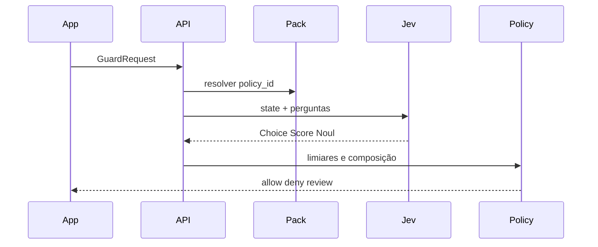

# Plano de implementação — Noulgate

Documento vivo na raiz do repositório. Fonte de verdade do desenho até o código existir.

**Produto:** Noulgate  
**Repo GitHub:** `noulgate`  
**Descrição:** *Decoupled action guardrail powered by Jev. Your code owns the verdict.*

Não prometemos ganho de custo, precisão, segurança ou latência antes de medir.

---

## 1. Para que serve

Noulgate é um **portão de ação** reutilizável. Qualquer sistema envia o que ia acontecer; o runtime devolve se pode seguir.

Veredito estável, independente do produto consumidor:

| Veredito | Significado |
| --- | --- |
| `allow` | Seguir. |
| `deny` | Bloquear. |
| `review` | Não autorizar automaticamente; humano ou fila. |

O Jev (TypeSafe AI, System One) **avalia** o `state` com perguntas tipadas. O **código** aplica a política, os limiares e o veredito. O Jev não gera texto, não executa tools e não concede permissão.

Cabe na frente de chat, agente com tools, copiloto interno, moderação, RAG — sem o núcleo conhecer esses produtos.

---

## 2. Objetivo do MVP

Runtime pequeno, funcional, explicável e reproduzível:

- Contrato HTTP + SDK Python (`GuardRequest` → `GuardDecision`).
- Dois packs de política versionados: `user_message.v1` e `tool_call.v1`.
- Providers `mock` (default) e `jev`.
- Console mínimo para colar um payload e inspecionar respostas + veredito.
- Dataset dourado e relatório mock vs Jev (quando houver chave).

Fora do v1: auth de produção, fila, multi-tenant, dashboard SaaS, gerador de texto, orquestrador de agentes.

---

## 3. Premissas do Jev (2026-10)

- System One: `state` + perguntas tipadas → respostas estruturadas.
- Primitivas: **Choice** (`choice`, `probabilities`, `confidence`), **Score** (`score`, `legend`, `probabilities`, `confidence`), **Noul** (`noul` 0–1, **sem** `confidence`).
- Perguntas da mesma chamada são atômicas e independentes. Composição fica no código.
- API: `POST https://api.typesafe.ai/v1/systemone`. Pin preferido: `jev-1.13.0` (`jev-latest` é alias mutável).
- SDK Python: `TypeSafeClient`. Gateway Vercel: `base_url=https://ai-gateway.vercel.sh/typesafe`, `AI_GATEWAY_API_KEY`, modelo `typesafe-ai/jev`.
- Não usar o schema `evaluate` da Vercel AI SDK (`boolean` no lugar de `noul`).
- Preço listado: **$0.042 / 1M tokens de entrada**; output TypeSafe gratuito. Créditos grátis do Jev no Gateway: **pendente**, não assumir.
- Jev é treinado principalmente em inglês. Packs v1 definem `state` em inglês. Qualidade em outros idiomas é hipótese a medir.

---

## 4. Arquitetura

Núcleo desacoplado. Domínio só em **packs**. Consumidores só em **adapters**.

```text
Sistema qualquer  →  HTTP / SDK  →  Noulgate core  →  DecisionProvider (mock | Jev)
                                      ↑
                         packs: user_message.v1 | tool_call.v1 | …
```

| Peça | Escolha | Papel |
| --- | --- | --- |
| API | FastAPI | `POST /v1/evaluate`, `GET /health`, `GET /v1/policies` |
| Contratos | Pydantic v2 | Request, decision, pack, provider |
| SDK | pacote `noulgate` | Cliente síncrono/async para embutir em outro sistema |
| Decisão | `DecisionProvider` | `MockProvider`, `TypeSafeGatewayProvider` |
| Política | `PolicyEngine` | Limiares, composição, `policy_version` |
| Packs | módulos registrados no código | Perguntas + regras; sem load remoto |
| Console | Jinja/HTMX mínimo | Demo local; não é o produto |
| Testes | pytest + httpx | Contrato, motor, packs no mock |
| Logs | JSON estruturado | Sem payload completo por default |

Não usamos LangChain, LangGraph, RAG, fila, Kubernetes, MCP, sessão de usuário nem LLM de redação.

### Um evaluate

1. Validar request (tamanho, `policy_id`, schema do payload).
2. Resolver pack versionado; recusar pack desconhecido.
3. Montar `state` limitado (instruções do pack vs texto não confiável vs fatos do caller).
4. Jev (ou mock) responde perguntas atômicas em uma chamada.
5. Motor aplica limiares e allowlists determinísticas do pack.
6. Persistência zero no v1; devolver `GuardDecision` + `request_id`.
7. Logar veredito, policy, confidence/noul — não logar segredos.



---

## 5. Contrato (estável)

O contrato público não menciona Jev. Trocar provider não muda o caller.

### `GuardRequest`

```python
{
  "policy_id": "tool_call.v1",          # obrigatório, versionado
  "action": "execute_tool",             # allowlist por pack
  "payload": { ... },                   # schema do pack
  "actor": { "id": "optional" },        # opcional; não é fonte de autorização
  "locale": "en",                       # default en; não traduz o state
  "dry_run": false
}
```

Limites v1: payload ≤ 32 KiB; uma política por request; rejeitar campos desconhecidos no topo.

### `GuardDecision`

```python
{
  "request_id": "uuid",
  "verdict": "allow" | "deny" | "review",
  "policy_id": "tool_call.v1",
  "policy_version": "1.0.0",
  "provider": "mock" | "jev",
  "answers": { ... },                   # primitivas normalizadas
  "reasons": ["destructive_action", "low_confidence"],
  "thresholds": { ... }                 # o que o motor usou
}
```

`actor` **não** autoriza. Ownership, authn/authz e schema da tool continuam no sistema consumidor.

---

## 6. Packs v1

Cada pack declara: `policy_id`, schema do `payload`, perguntas, limiares, mapa resposta → `reasons` → veredito.

Perguntas estreitas, observáveis, em inglês. Sem “isso é seguro?”. Sem extrair IDs — IDs vêm do payload e são validados no código.

### `user_message.v1`

Payload: `{ "text": str, "channel"?: str }`.

| Id | Tipo | Pergunta (ideia) |
| --- | --- | --- |
| `intent_class` | Choice | `inform` / `request_action` / `jailbreak` / `abuse` / `unknown` |
| `policy_violation` | Noul | A mensagem pede para ignorar regras ou extrair segredos? |
| `user_risk` | Score | Rubrica de risco observável (neutro → explícito) |

Motor (hipótese inicial, ajustar com eval):

- `deny` se `jailbreak`/`abuse` com confidence ≥ limiar **ou** `policy_violation` ≥ 0.85
- `review` se confidence baixa, `unknown`, ou noul no meio
- senão `allow`

### `tool_call.v1`

Payload: `{ "tool": str, "args": object, "proposed_by": "model"|"user"|"system" }`.

Allowlist de tools no pack (exemplos): `lookup`, `draft_reply`, `cancel_order`, `refund`, `delete_record`. Tools fora da lista → `deny` determinístico, sem chamar o Jev.

| Id | Tipo | Pergunta (ideia) |
| --- | --- | --- |
| `action_class` | Choice | `read` / `write` / `destructive` / `unknown` |
| `destructive` | Noul | A chamada altera ou apaga estado de forma irreversível? |
| `args_on_policy` | Noul | Os argumentos visíveis são coerentes com um uso legítimo da tool? |

Motor:

- tool fora da allowlist → `deny` (`unknown_tool`)
- `destructive` alto + `proposed_by=model` → `review` ou `deny` conforme limiar
- confidence baixa em `action_class` → `review`
- senão `allow`

Packs seguintes (não v1): `llm_output.v1` (alucinação vs contexto), `publish_content.v1`.

---

## 7. Providers e modos

| Modo | Comportamento |
| --- | --- |
| `mock` (default) | Sem credenciais e sem rede. Fixtures por `policy_id` + hash do payload. Demo e testes; **não** mede o modelo. |
| `jev` | TypeSafe Gateway ou API oficial. Mesmo contrato. |

Variáveis: `NOULGATE_PROVIDER=mock|jev`, `AI_GATEWAY_API_KEY` ou chave TypeSafe, `NOULGATE_JEV_MODEL=jev-1.13.0`.

Falhas do provider: não virar `allow`. Timeout/erro → `review` com reason `provider_error`, HTTP 200 no evaluate (o caller decide) **ou** 503 se `fail_closed=true` (config). Default do MVP: `review` + flag `degraded=true`.

---

## 8. Guardrails em camadas (o Jev não substitui)

Ordem no evaluate:

1. Schema e tamanho (Pydantic)
2. Allowlist de `action` / `tool`
3. Regras determinísticas do pack (campos obrigatórios, tipos)
4. Avaliação Jev / mock
5. Motor de limiares

Noulgate **não** é: autenticação, WAF, DLP/PII dedicado, sandbox, IAM. Pode coexistir com regex/PII ao lado, no pack ou no caller.

Confidence alto não prova acerto. Distribuição concentrada pode estar errada. Incerteza → `review`, nunca `allow` por omissão.

---

## 9. Console e DX

- `GET /` — formulário: escolher pack, colar JSON, ver veredito, answers, reasons.
- Banner claro do provider (`mock` vs `jev`).
- `GET /v1/policies` — lista packs e versões.

Sem cookie de sessão. Sem login no MVP.

SDK:

```python
from noulgate import NoulgateClient

client = NoulgateClient(base_url="http://localhost:8000")
decision = client.evaluate(
    policy_id="tool_call.v1",
    action="execute_tool",
    payload={"tool": "refund", "args": {"order_id": "demo"}, "proposed_by": "model"},
)
assert decision.verdict in {"allow", "deny", "review"}
```

---

## 10. Testes e eval

Separar software de qualidade do modelo.

- **pytest:** schema, allowlist, composição, fail-closed, contrato HTTP, mock determinístico.
- **golden:** 20–40 casos por pack (allow/deny/review esperados no *motor* dado answers fixas; plus fixtures mock).
- **eval Jev (opcional, CI manual):** só com chave; tabela acurácia vs labels humanas; **não** gate de merge no início.
- Sem Playwright no v1 (console é opcional).

---

## 11. Layout do repo

```text
noulgate/
  pyproject.toml
  README.md
  PLANO.md
  LICENSE
  src/noulgate/
    __init__.py
    contracts.py
    engine.py
    providers/
      base.py
      mock.py
      typesafe.py
    packs/
      registry.py
      user_message_v1.py
      tool_call_v1.py
    api.py
    client.py
  templates/console.html
  tests/
  eval/golden/
```

---

## 12. Fases

1. **Contrato + mock** — Pydantic, engine, dois packs, API, testes do motor, console. Zero rede.
2. **SDK + README** — cliente, exemplos `examples/`, quickstart.
3. **Provider Jev** — adapter TypeSafe/Gateway, pin de modelo, testes de contrato do adapter (fixtures gravadas).
4. **Eval** — golden labels, script de relatório, documentar o que falta medir.
5. **Pack extra (opcional)** — `llm_output.v1` só depois do contrato estar estável.

Critério de “pronto para GitHub público”: fase 1 + README em inglês + `.env.example` + declaração de direitos (código original sem licença MIT) + `mock` funcionando sem chave.

---

## 13. Fora de escopo (explícito)

- Chat, sessão, templates de resposta ao usuário final.
- Executar a tool após o veredito.
- Carregar pack por URL ou código remoto.
- Multi-instância compartilhada / store.
- Prometer conformidade legal, segurança certificada ou calibração perfeita.

---

## 14. Nome e posicionamento

**Noulgate** — portão de ação. *Noul* é a primitiva TypeSafe de “isto é verdadeiro?”; *gate* é o papel no sistema.

Não é um firewall completo. É a **base de julgamento** que um produto evolui via packs, sem reescrever o núcleo.
